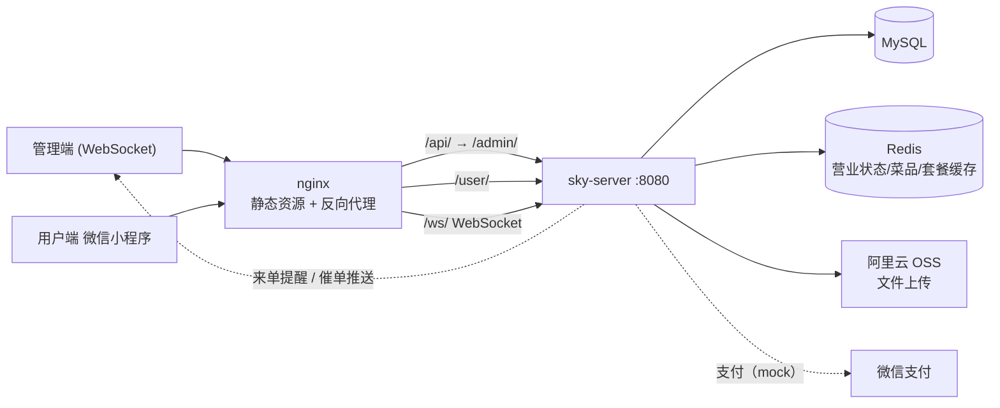

# 苍穹外卖 SkyTakeOut 🍱

基于 Spring Boot 的外卖点餐系统，包含**管理端（Web）**与**用户端（微信小程序）**，覆盖员工管理、菜品/套餐管理、订单、数据统计、工作台等完整业务闭环。

> 本项目为学习型项目，基础功能跟随课程完成，目前正在进行自主打磨与性能改造，改造计划与效果记录见文末 [路线图](#-路线图)。

## 技术栈

| 分类 | 技术 | 版本 |
|---|---|---|
| 基础框架 | Spring Boot | 2.7.3 |
| ORM | MyBatis（XML + 注解） | 2.2.0 |
| 数据库 | MySQL + Druid 连接池 | Druid 1.2.1 |
| 分页 | PageHelper | 1.3.0 |
| 缓存 | Redis（RedisTemplate + Spring Cache） | 随 SpringBoot |
| 认证 | JWT（jjwt） | 0.9.1 |
| 实时通信 | WebSocket（来单提醒 / 催单） | 随 SpringBoot |
| 接口文档 | Knife4j（Swagger） | 3.0.2 |
| 文件存储 | 阿里云 OSS | 3.10.2 |
| 报表导出 | Apache POI | 3.16 |
| 支付 | 微信支付 SDK（mock 联调） | 0.4.8 |
| 其他 | Lombok / Fastjson / PageHelper | — |

## 系统架构



## 工程结构

```text
sky-take-out
├── sky-common    公共模块：常量 / 异常 / Result / JWT·OSS·微信支付工具 / ThreadLocal 上下文
├── sky-pojo      数据模型：Entity 11 个 / DTO 21 个 / VO 17 个
└── sky-server    后端服务（:8080）
    ├── controller/admin   管理端接口（9 个 Controller）
    ├── controller/user    用户端接口（8 个 Controller）
    ├── service / mapper   业务逻辑与持久层
    ├── task               订单状态定时任务（计划改造为 MQ 延迟消息）
    ├── websocket          来单提醒 / 催单推送
    └── resources          配置、mapper XML、报表模板
```

## 核心功能

**管理端**（Web）

| 模块 | 功能 |
|---|---|
| 员工管理 | 登录 / 退出 / 新增 / 分页查询 / 启用禁用 / 编辑 |
| 分类管理 | 菜品分类、套餐分类的增删改查与启禁用 |
| 菜品管理 | 新增（多口味）/ 分页 / 批量删除 / 修改 / 起售停售 |
| 套餐管理 | 新增 / 分页 / 批量删除 / 修改 / 起售停售 |
| 订单管理 | 搜索、各状态数量统计、接单 / 拒单 / 取消 / 派送 / 完成 |
| 数据统计 | 营业额 / 用户 / 订单统计、销量 Top10、Excel 报表导出（POI） |
| 工作台 | 今日数据、订单管理、菜品总览、套餐总览 |
| 其他 | 店铺营业状态设置、文件上传（OSS） |

**用户端**（微信小程序）

| 模块 | 功能 |
|---|---|
| 菜单 | 分类查询、按分类查菜品 / 套餐、套餐内菜品 |
| 购物车 | 添加 / 查询 / 删除 / 清空 |
| 订单 | 下单、支付（mock）、历史订单、订单详情、取消、再来一单、催单 |
| 其他 | 微信登录、地址簿管理、店铺营业状态查询 |

## 快速开始

### 环境要求

- JDK 8+、Maven 3.x、MySQL 8.x、Redis、（管理端）nginx

### 步骤

```bash
# 1. 建库（库名 sky_take_out，含示例数据）
mysql -uroot -p < doc/sky.sql

# 2. 创建配置文件 sky-server/src/main/resources/application-dev.yml
#    （该文件被 .gitignore 排除，模板见下方）

# 3. 打包并启动后端（:8080）
mvn clean package -Dmaven.test.skip=true
java -jar sky-server/target/sky-server-*.jar

# 4. 启动管理端前端（Windows 自带 nginx，已配好反向代理）
front/nginx-1.20.2/nginx.exe
#    浏览器访问 http://localhost/   默认账号 admin / 123456
```

**接口文档**：后端启动后访问 Knife4j 文档 `http://localhost:8080/doc.html`

**用户端**：微信开发者工具导入 `微信小程序源代码/mp-weixin`（外层课程资料目录）

### application-dev.yml 模板

字段名与 `application.yml` 中 `${sky.*}` 占位符一一对应，此文件被 `.gitignore` 排除，**需自行创建，切勿提交真实密钥**：

```yaml
sky:
  datasource:
    driver-class-name: com.mysql.cj.jdbc.Driver
    host: localhost
    port: 3306
    database: sky_take_out
    username: root
    password: <数据库密码>
  redis:
    host: localhost
    port: 6379
    password: <Redis密码，无则留空>
    database: 10
  alioss:
    endpoint: oss-cn-<区域>.aliyuncs.com
    access-key-id: <你的OSS AK>
    access-key-secret: <你的OSS SK>
    bucket-name: <你的bucket>
  wechat:
    appid: <小程序appid>
    secret: <小程序secret>
    mchid:                # 以下支付项留空即可（支付为 mock 模式）
    mchSerialNo:
    privateKeyFilePath:
    apiV3Key:
    weChatPayCertFilePath:
    notifyUrl:
    refundNotifyUrl:
  shop:
    address: <店铺地址>
  baidu:
    ak: <百度地图AK>
```

> 说明：微信支付当前为 **mock 联调**（真实调用需企业商户资质），`mchid` 等支付配置留空不影响其余功能。默认管理员账号 `admin / 123456`。

## 路线图

正在按计划改造，完成后在下方表格回填量化效果：

| 改造项 | 内容 | 状态 | 效果记录 |
|---|---|---|---|
| ✅ 基础缓存 | 店铺营业状态（RedisTemplate）、菜品查询（RedisTemplate）、套餐查询（Spring Cache） | 已完成 | — |
| 🔲 缓存三件套 | 统一 CacheClient 工具类，穿透（空值缓存）+ 击穿（互斥锁 / 逻辑过期）处理 | 计划中 | 待压测 |
| 🔲 MQ 延迟消息 | 订单超时取消由 Spring Task 改为 RabbitMQ 延迟消息 | 计划中 | — |
| 🔲 容器化部署 | Docker Compose 一键部署 nginx + MySQL + Redis + 后端 | 计划中 | — |
| 🔲 性能压测 | JMeter 对缓存改造前后接口压测对比 | 计划中 | — |
