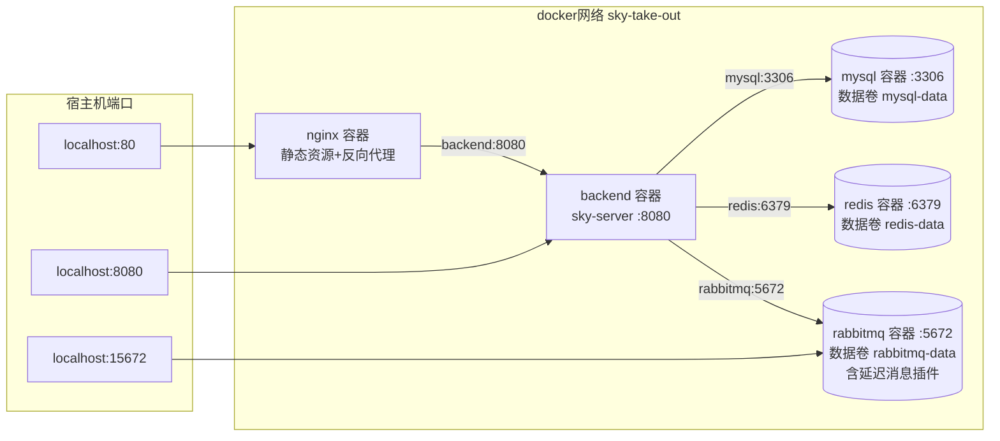

# 苍穹外卖 Docker Compose 部署说明

> 目标读者：第一次做容器化部署的自己。
> 这份文档不只是命令清单，还会解释**每个文件为什么存在、每条命令背后发生了什么**，照着做完你就拥有一个 `docker compose up -d` 一键启动的完整外卖系统。

---

## 0. 部署后的整体形态



几个关键设计决策（也是常见疑问）：

| 决策 | 原因 |
|---|---|
| 容器之间用**服务名**互访（`mysql`、`redis`、`rabbitmq`、`backend`） | Compose 会把服务名注册进内部 DNS，跨容器不写 IP/localhost |
| MySQL/Redis **不映射宿主机端口** | 本机原生 MySQL(3306)/Redis(6379) 服务占着端口会冲突；容器互访走内网根本不需要映射。要用 Navicat 看容器库见 §3 |
| 后端配置用**外置挂载**而不是改代码 | `deploy/config/application-dev.yml` 挂到容器 `/app/config/`，Spring Boot 约定外置配置优先级高于 jar 内同名文件，profile 仍是 `dev`，零代码改动 |
| RabbitMQ 用**自建用户 sky** | 官方镜像的 `guest` 账号只允许本机(容器内)登录，跨容器连接会被拒，必须自建用户 |
| 时区统一 `Asia/Shanghai` | 订单超时判定、营业额按天统计都对时间敏感，容器默认是 UTC，不改会差 8 小时 |
| `doc/sky.sql` 挂到 initdb 目录 | MySQL 官方镜像**首次**用空数据卷启动时会自动执行里面的建库脚本；之后重启不会再执行（数据在卷里） |

---

## 1. 文件清单（每个文件为什么存在）

| 文件 | 作用 |
|---|---|
| `Dockerfile`（仓库根） | 后端镜像：`eclipse-temurin:8-jre` 基础镜像 + 打好的 fat jar。项目是 Java 8，所以选 JRE 8 镜像 |
| `.dockerignore`（仓库根） | 白名单模式，构建上下文只放行 `sky-server/target/*.jar`，避免 `.git`、源码、课程资料被上传进镜像构建 |
| `docker-compose.yml`（仓库根） | 5 个服务的编排：mysql / redis / rabbitmq / backend / nginx，含健康检查与启动依赖 |
| `deploy/rabbitmq/Dockerfile` | 官方 `rabbitmq:3.13-management` 镜像**不含**延迟消息插件，叠加一层装上 `rabbitmq_delayed_message_exchange-3.13.0.ez` 并离线启用。插件版本必须与 Broker 版本匹配（3.13.0 ↔ 3.13） |
| `deploy/nginx/nginx.conf` | 容器版 nginx 配置，复刻课程版 `conf/nginx.conf`，只改两处：上游 `localhost:8080` → `backend:8080`；root 改容器内绝对路径 |
| `deploy/nginx/html/sky/` | 管理端前端构建产物（从课程资料 `nginx-1.20.2/html/sky` 拷贝），直接由 nginx 容器托管 |
| `deploy/config/application-dev.yml` | **容器版**后端配置（被 `.gitignore` 排除，含 OSS/微信密钥不进仓库）：host 改为服务名，密码用容器约定的 `sky123456`。**克隆/换机器后需要重新生成**，方法见下 |

> 容器版配置与本地开发配置是两套独立密码体系：本地开发继续用你原来的 MySQL/Redis/RabbitMQ（IDEA 跑项目不受任何影响），容器栈只认 `docker-compose.yml` 里约定的密码。

---

## 2. 首次部署七步

以下命令默认在仓库根 `D:\Project\SkyTakeOut\sky-take-out\` 执行，Git Bash / PowerShell 均可。

### ① 启动 Docker Desktop 并确认引擎就绪

启动 Docker Desktop，等左下角鲸鱼图标变绿（首次启动 WSL2 可能要一两分钟），然后验证：

```bash
docker version
```

`Server` 段有输出（Engine 版本号）才算引擎真正起来了，只有 `Client` 段说明引擎还没就绪。

### ② 确认容器版配置存在

`deploy/config/application-dev.yml` 已预生成（本机）。**换机器或文件丢失时**这样重建：

1. 复制本地开发配置 `sky-server/src/main/resources/application-dev.yml` 一份到 `deploy/config/application-dev.yml`；
2. 改 5 处：
   - `spring.rabbitmq.host`：`localhost` → `rabbitmq`；`username/password`：`guest` → `sky / sky123456`
   - `sky.datasource.host`：`localhost` → `mysql`；`password` → `sky123456`
   - `sky.redis.host`：`localhost` → `redis`；`password` → `sky123456`
3. 其余（OSS、微信 appid/secret、百度 ak、`sky.order.delay-seconds`）原样保留。

> 若该文件不存在就执行 `docker compose up`，Docker 会把它当成**目录**挂载导致后端起不来——这是最常见的翻车点。

### ③ 打包后端 jar

```bash
mvn clean package "-Dmaven.test.skip=true"
```

成功标志：`BUILD SUCCESS`，且 `sky-server/target/sky-server-1.0-SNAPSHOT.jar` 存在。
IDEA 里操作等价于：右侧 Maven 面板 → `sky-server` → Lifecycle → 双击 `package`（先 clean）。

> 为什么不在 Docker 里编译？多阶段构建要在容器内重新下载全部 Maven 依赖，又慢又占空间；本机已有依赖缓存，打包更快。这也是"改代码 → 更新部署"两步走的原因（见 §3）。

### ④ 一键构建并启动

```bash
docker compose up -d --build
```

这一条命令背后发生的事（按顺序）：

1. 构建 `deploy/rabbitmq` 镜像（官方镜像 + 延迟插件）；
2. 构建后端镜像（Dockerfile：JRE8 + jar）；
3. 拉取 `mysql:8.0`、`redis:6.2-alpine`、`nginx:1.20.2`、`rabbitmq:3.13-management`、`eclipse-temurin:8-jre`（首次约 3-10 分钟，取决于网络）；
4. 按依赖顺序启动：mysql/redis/rabbitmq → 各自健康检查通过 → backend → nginx；
5. mysql 首次启动自动执行 `doc/sky.sql`（建库 `sky_take_out` + 11 张表 + 示例数据）。

### ⑤ 检查状态与日志

```bash
docker compose ps          # 5 个容器都应是 Up / Up (healthy)
docker compose logs -f backend   # 看到 "Started SkyApplication in x.xx seconds" 即启动成功
```

backend 第一次可能因为 MySQL 还在初始化而重启一两次（`restart: unless-stopped` 会自动拉起），只要最终 `Up (healthy)` 附近稳定即可。Ctrl+C 退出日志跟踪。

### ⑥ 冒烟验证清单

| 检查点 | 地址 / 操作 | 预期 |
|---|---|---|
| 管理端前端 | http://localhost | 登录页正常，`admin / 123456` 能登录，各页面数据可加载 |
| 接口文档 | http://localhost:8080/doc.html | Knife4j 文档可打开 |
| MQ 延迟交换机 | http://localhost:15672（`sky / sky123456`）→ Exchanges | 存在 `sky.order.delay.exchange`，Type 为 `x-delayed-message`（后端启动时自动声明） |
| Redis 缓存 | `docker exec sky-redis redis-cli -a sky123456 -n 10 keys "*"` | 有缓存 key（菜品/套餐查询后） |

> 改造②的专项验证：把 `deploy/config/application-dev.yml` 里 `sky.order.delay-seconds` 临时改为 `10`，`docker compose restart backend`，在小程序端下一单后等 10 秒，管理端订单状态应变"已取消"。验完改回 `900` 并重启。

### ⑦ 提交部署材料

冒烟验证全部通过后，把部署材料提交 GitHub：

```bash
git add Dockerfile .dockerignore docker-compose.yml deploy/ doc/部署说明.md README.md .gitignore
git commit -m "feat: Docker Compose 容器化部署（nginx+MySQL+Redis+RabbitMQ延迟插件+后端），附部署说明"
git push
```

注意 `deploy/config/application-dev.yml` 已被 `.gitignore` 排除，`git status` 里不应出现它；如果出现了，说明忽略规则没生效，先停下检查再提交。

---

## 3. 日常使用

| 场景 | 命令 |
|---|---|
| 开机后启动整套 | `docker compose up -d` |
| 停止（保留容器） | `docker compose stop` |
| 停止并删容器（数据卷保留） | `docker compose down` |
| **重置数据库/MQ/Redis 到初始状态** | `docker compose down -v && docker compose up -d`（`-v` 连数据卷一起删，下次启动重新执行 sky.sql） |
| 看某个服务日志 | `docker compose logs -f backend`（或 mysql / nginx / rabbitmq） |
| 进容器排查 | `docker exec -it sky-backend sh` |

**改了 Java 代码后如何更新部署（做完改造③-b 后就是这个流程）：**

```bash
mvn clean package "-Dmaven.test.skip=true"
docker compose up -d --build backend
```

只有后端镜像重建、只有后端容器重启，MySQL/Redis/RabbitMQ/nginx 与其中的数据完全不动——这就是"部署先行"带来的迭代闭环，一次更新约 1 分钟。

**临时用 Navicat 看容器库**：在 `docker-compose.yml` 的 `mysql.services.ports` 下补一行 `- "13306:3306"`，`docker compose up -d mysql`，然后 Navicat 连 `127.0.0.1:13306`（root / sky123456）。用完建议删掉该映射。

---

## 4. FAQ / 排错

**Q1：`docker compose up` 报端口被占用（80 / 8080 / 15672）**
宿主机 80 被 IIS 或其他 nginx 占用时，把 compose 里 nginx 端口改为 `"8000:80"`，前端改访问 http://localhost:8000。8080 被占用说明你 IDEA 里还跑着本地后端，停掉它。

**Q2：backend 一直重启 / 日志里 Connection refused**
八成是三大件还没就绪或容器版配置不对：`docker compose ps` 看谁不健康，`docker compose logs mysql` 排查；再确认 `deploy/config/application-dev.yml` 存在且非空（见 §2 步骤②）。

**Q3：RabbitMQ 连接被拒（access_refused / guest）**
官方镜像 guest 账号禁止跨容器登录。本项目已用自建用户 `sky / sky123456`（compose 的 `RABBITMQ_DEFAULT_USER/PASS`），确认容器版配置里 username/password 与之一致。

**Q4：Exchanges 里没有 `sky.order.delay.exchange`**
该交换机由后端 `RabbitMQConfiguration` 在启动时声明，后端没起来就不会有；先解决 backend 的问题。若插件没装上，`docker compose logs rabbitmq` 会有报错，检查 `deploy/rabbitmq/` 下的插件文件版本是否为 3.13.0。

**Q5：时间不对 / 统计报表按天分桶错位**
容器默认 UTC。本方案已在 mysql（`--default-time-zone=+08:00` + TZ）、backend（TZ + `user.timezone`）统一为 Asia/Shanghai，且 JDBC URL 自带 `serverTimezone=Asia/Shanghai`，正常不会出现；若手动改过 compose，检查这三处。

**Q6：改了 doc/sky.sql 想重新初始化**
initdb 脚本只在**空数据卷**时执行。`docker compose down -v` 后重新 `up -d` 即可（注意会清空所有业务数据）。

**Q7：镜像拉取很慢 / 失败**
Docker Desktop → Settings → Docker Engine 里配置镜像加速器后重启 Docker。延迟插件 `.ez` 已随仓库提交，无需再下载；若换新版本 Broker，去 [rabbitmq-delayed-message-exchange releases](https://github.com/rabbitmq/rabbitmq-delayed-message-exchange/releases) 下载匹配版本的 `.ez` 放进 `deploy/rabbitmq/` 并同步改 Dockerfile。

**Q8：想把整套环境完全删掉重来**
`docker compose down -v --rmi local`（删容器+卷+本地构建的镜像），远端拉取的镜像可用 `docker image prune` 清理。

---

## 5. 下一步衔接：JMeter 压测

部署稳定后，按路线图进行改造③-a：JMeter 三组对比压测（热缓存 / 缓存未命中重建 / 穿透拦截）。

- **压测对象**：`http://localhost:8080`（容器化后端，本机 IDEA 后端应停掉，避免干扰数据）
- 用户端接口带 JWT，JMeter 需加 `authentication` 请求头：先调 `/user/user/login`（需微信 code）不方便抓包的话，可用 JwtUtil 单测生成，或直接压管理端接口（`token` 头，登录接口响应体里取）
- 指标：TPS、P95/P99、错误率；数据回填 README 路线图表与简历

---

*文档对应代码版本：master @ 51f627a（2026-11-14）。部署材料：Dockerfile、.dockerignore、docker-compose.yml、deploy/、本文档。*
